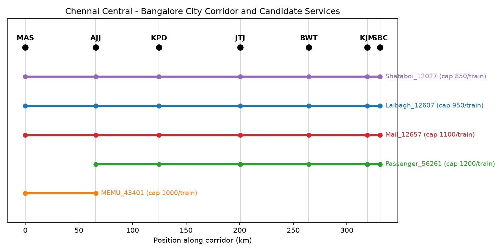
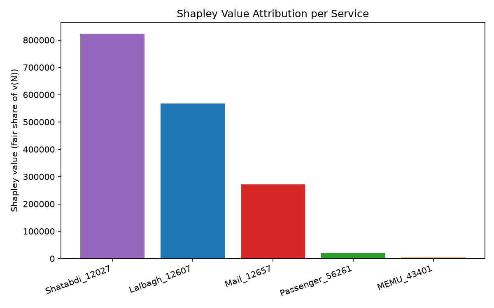
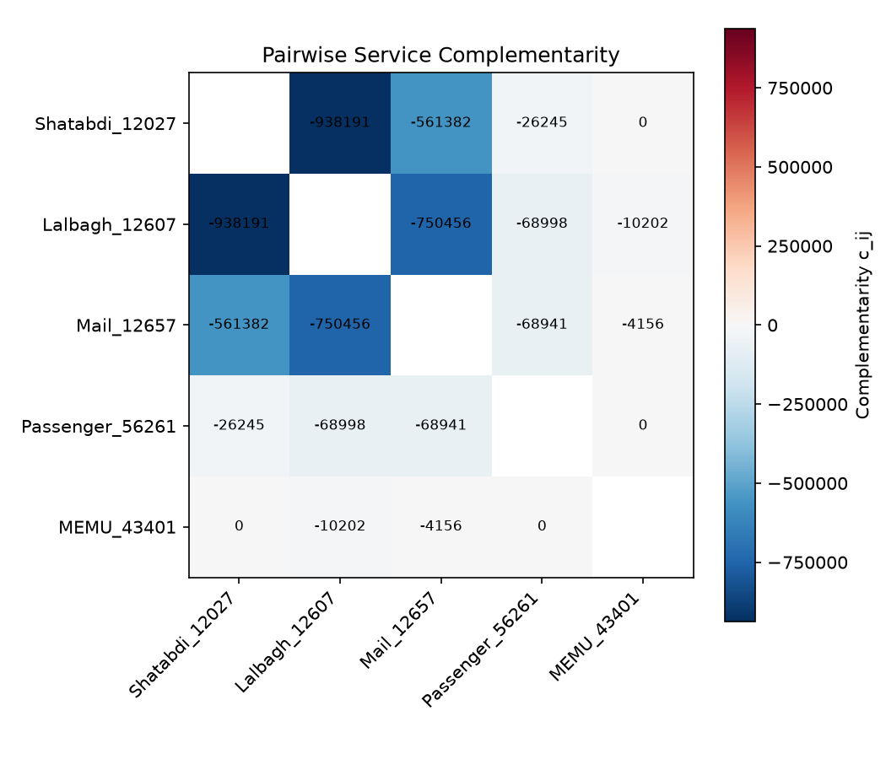
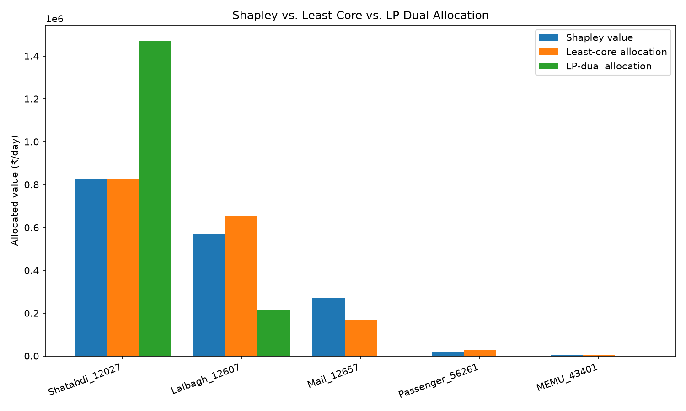
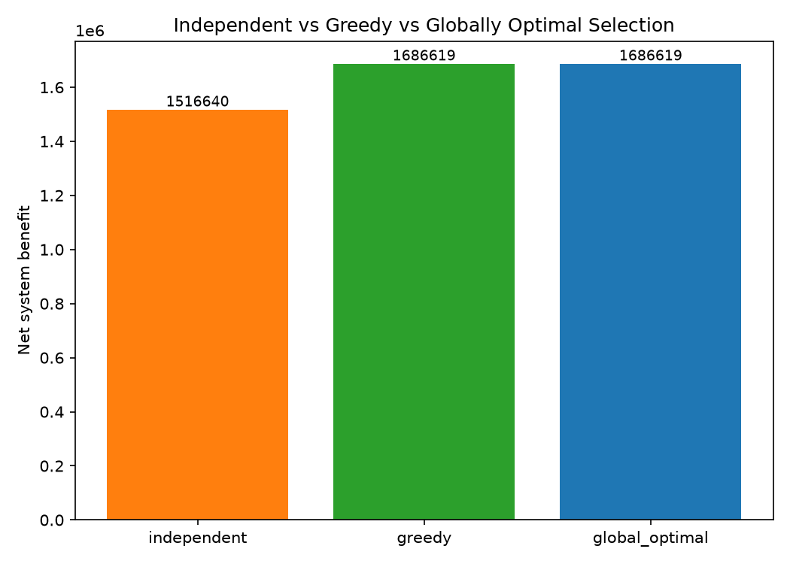

# Cooperative Game Theory for Railway Service Selection and Seat Allocation

A reproducible research prototype for an MTech thesis on applying
**cooperative game theory** (characteristic functions, the Shapley value,
pairwise complementarity) to **railway service selection and O-D seat
allocation**, with the underlying selection/allocation problem itself
solved as a **Mixed-Integer Linear Program (MILP)**.

This runs on **real Indian Railways data**: a real corridor of real
stations with real geographic coordinates, and 5 real, currently-operating
named trains with their real routes, distances and class composition
(sourced from a public Kaggle dataset built from Indian Railways' own
published timetable data). Every number in `results/` is produced by
actually solving 32 MILPs (one per coalition of the 5 real services) with
the open-source CBC solver via PuLP, and every claim (efficiency of the
Shapley value, capacity/demand feasibility, dominance of the grand
coalition) is checked by an automated test.

---

## 1. Problem statement

Given:

- A railway **network**: stations and the physical track segments joining
  them.
- **O-D passenger demand**: how many passengers want to travel from each
  origin to each destination, and what fare they pay.
- **Candidate train services**: each with a fixed route (ordered sequence
  of stops), a per-train seating capacity, an operating cost per train
  (frequency unit) per day, and a maximum number of trains/day.

Decide:

- **Which services to run** (service selection),
- **At what frequency** (trains/day),
- **How to allocate O-D passengers to seats** on the running services,

so as to **maximise net system benefit** (fare revenue minus operating
cost) subject to **seat capacity** and **demand** constraints. This
selection/allocation problem is then reinterpreted as a **cooperative
game** among the candidate services, to answer: *how much does each
service actually contribute to the system, and does independent,
uncoordinated planning leave value on the table?*

---

## 2. The real dataset

**Source.** [`sripaadsrinivasan/indian-railways-dataset`](https://www.kaggle.com/datasets/sripaadsrinivasan/indian-railways-dataset)
on Kaggle (CC0 Public Domain), built from Indian Railways' own published
NTES/timetable data: `stations.json` (every IR station, with real
coordinates), `trains.json` (every train, with real route endpoints,
distance and class composition) and `schedules.json` (the real stop-by-
stop timetable of every train). A curated extract containing just the
records used here is checked in at
[`data/real_corridor_source.json`](data/real_corridor_source.json) (the
full raw files are ~98 MB and are not kept in this repo -- see
"Reproducing the raw download" below).

**Corridor.** The real Chennai Central -- Bangalore City mainline, 7 real
stations in their real physical order (confirmed both by real coordinates
and by the real recorded stop order of the trains below):

| Code | Station | Real population served (approx., 2011 Census) |
|---|---|---|
| MAS | Chennai Central | 7,088,000 (city) |
| AJJ | Arakkonam | 74,000 (town) |
| KPD | Katpadi Jn (Vellore) | 504,000 (city) |
| JTJ | Jolarpettai | 20,000 (town) |
| BWT | Bangarapet | 35,000 (town) |
| KJM | Krishnarajapuram | 60,000 (local station catchment) |
| SBC | Bangalore City Jn | 8,443,675 (city) |

Segment distances ([`data/segments.csv`](data/segments.csv)) are real
great-circle (haversine) distances computed from each station's real
coordinates.

**Candidate services.** 5 real, currently-named Indian Railways trains
that actually run on this corridor, with their real train numbers, real
origin/destination, real distance, and real class composition (which of
the 7 corridor stations each train actually stops at is reconstructed
from the real schedule data):

| Service | Real train | Real stops | Category |
|---|---|---|---|
| `Shatabdi_12027` | 12027 Chennai Central-Bangalore City Shatabdi Exp | all 7 | premium AC chair car |
| `Lalbagh_12607`  | 12607 Chennai Central-Bangalore Lalbagh Exp | all 7 | superfast chair car |
| `Mail_12657`     | 12657 Chennai-Bangalore Mail | all 7 | mixed 1A/2A/3A/Sleeper |
| `Passenger_56261`| 56261 Arakkonam-Bangalore Passenger | AJJ..SBC (6) | unreserved passenger |
| `MEMU_43401`     | 43401 Chennai Central-Arakkonam Fast | MAS..AJJ (2) | commuter MEMU |



### What is real vs. what is modelled

**Real:** station identities, real coordinates, the real physical corridor
order, segment distances (real haversine distance from real coordinates),
train identities/numbers/names, which of the 7 corridor stations each
train actually stops at (from the real schedule data), and each train's
broad real class composition (which of 1A/2A/3A/Sleeper/Chair-Car it
carries).

**Modelled (clearly separated, documented in `src/network.py`, not claimed
as live or confidential operational data):**

- **Seating capacity per train** and **operating cost per train-km** --
  the source dataset only records *which* classes a train carries (0/1
  flags), not real coach counts, and Indian Railways does not publish
  per-train operating cost. These are looked up by train category from
  standard, publicly documented typical IR rake compositions and
  representative train-km cost ranges (`CAPACITY_BY_CATEGORY`,
  `COST_PER_KM_BY_CATEGORY` in `src/network.py`).
- **Fare per passenger-km** -- representative, approximate IRCTC
  base-fare-per-class slabs, blended per category (`FARE_PER_KM_BY_CATEGORY`).
  Real IR fares differ by class/train for the same physical trip, so fare
  is service-specific here, not a single OD-level number.
- **O-D passenger demand** -- Indian Railways does not publish
  station-level ticketing O-D matrices. Demand is synthesised with a
  **gravity model calibrated on real (approximate 2011-census) town/city
  population** actually served by each station:

  ```
  demand_ij = K * sqrt(pop_i * pop_j) / max(dist_ij, 15 km)
  ```

  (square root on the population product avoids the classic gravity-model
  blow-up where the two biggest endpoints swamp every other pair; the
  15 km distance floor represents a fixed station-access/interchange
  "friction" that does not vanish as physical distance shrinks to zero,
  which keeps the very short KJM-SBC suburban segment well-behaved). `K`
  was hand-calibrated once so the two metro termini land at a plausible
  order of magnitude (~1,700 daily rail passengers between Chennai and
  Bangalore). This is a standard, transparent technique for estimating
  demand where ticketing microdata is restricted -- it is reported here as
  exactly that: a population-calibrated estimate, not observed ridership.

### Reproducing the raw download

```bash
# via the Kaggle API/CLI (needs a free Kaggle account + API token)
kaggle datasets download -d sripaadsrinivasan/indian-railways-dataset
# then filter stations.json / trains.json / schedules.json to station
# codes MAS, AJJ, KPD, JTJ, BWT, KJM, SBC and train numbers 12027, 12607,
# 12657, 56261, 43401 to reproduce data/real_corridor_source.json
```

---

## 3. The linear relation `L = A x`

Let `x` be the stacked vector of **O-D seat-assignment variables**
`y_{s,od}` (passengers of O-D pair `od` carried on service `s`), one entry
per (service, servable O-D pair). Let `L` be the vector of **segment
loads**, one entry per (service, segment) actually traversed by that
service's route. Then

```
L = A x
```

where `A` is a 0/1 **incidence matrix**: `A[(s,e), (s,o,d)] = 1` iff the
direct path of O-D pair `(o,d)` crosses segment `e` *and* `e` lies on
service `s`'s own route. `A` is built explicitly in
[`src/network.py::build_assignment_matrix`](src/network.py) and is what
turns the MILP's capacity constraints into one line per row of `A`:
`L_{s,e} <= capacity_s * frequency_s`. `tests/test_network.py` checks this
relation directly against a brute-force recomputation of `L`.

---

## 4. MILP formulation

**Sets:** services `S`, O-D pairs `OD`, track segments `E`.

**Variables**

- `f_s ∈ {0, …, maxFreq_s}` — integer frequency (trains/day) of service `s`
- `y_{s,od} ≥ 0` — continuous passengers of O-D pair `od` carried by
  service `s` (only defined where `s` can physically serve `od`)

**Objective**

```
max  Σ_{s,od} fare_{s,od} · y_{s,od}   −   Σ_s cost_s · f_s
```

where `fare_{s,od} = fare_per_km_s · distance_od` is service-specific
(real IR fares differ by class/train for the same trip).

**Constraints**

```
(1) Demand:    Σ_{s servable} y_{s,od} ≤ demand_od                  ∀ od
(2) Capacity:  L_{s,e} = Σ_{od covering e on s} y_{s,od} ≤ cap_s · f_s   ∀ (s,e)
(3) Coalition: f_s = 0                           ∀ s ∉ coalition S   (when solving v(S))
(4) Bounds:    0 ≤ f_s ≤ maxFreq_s (integer),    y_{s,od} ≥ 0
```

Implemented in [`src/milp.py`](src/milp.py) with PuLP + CBC
(`solve_service_selection_milp`). Passing `coalition=None` solves the full
(grand-coalition) problem, which — because frequency can always be driven
to 0 — automatically finds the globally optimal **subset** of services as
well as their frequencies and allocation.

---

## 5. Cooperative game formulation

The 5 real candidate services are the **players** `N`. For each coalition
`S ⊆ N`, the **characteristic function**

```
v(S) = optimal objective of the MILP above, restricted to services in S
```

is the maximum net system benefit obtainable using only services in `S`
(services in `S` that are not worth running are simply left at frequency
0 — the coalition is never forced to activate a member). `v(∅) = 0` by
convention. All `2^5 = 32` coalitions are enumerated and solved in
[`src/characteristic_function.py`](src/characteristic_function.py); the
grand coalition's MILP is, by construction, also the global social
optimum.

### Shapley value

```
φ_i = Σ_{S ⊆ N\{i}}  [ |S|! (n-|S|-1)! / n! ] · [ v(S ∪ {i}) − v(S) ]
```

computed in [`src/shapley.py`](src/shapley.py) directly from the 32
pre-computed coalition values. `φ_i` is each service's *fair* share of the
grand-coalition value, satisfying **efficiency** (`Σ φ_i = v(N)`), which is
verified both at runtime (`verify_efficiency`) and in
`tests/test_shapley.py`, along with the **symmetry** and **null-player**
axioms on hand-constructed toy games.

On this corridor:

| Service | Shapley value (₹/day) |
|---|---|
| `Shatabdi_12027` | 823,640 |
| `Lalbagh_12607`  | 567,049 |
| `Mail_12657`     | 271,185 |
| `Passenger_56261`| 20,817 |
| `MEMU_43401`     | 3,929 |



### Pairwise complementarity

```
c_ij = v({i,j}) − v({i}) − v({j})
```

`c_ij > 0` ⇒ services `i, j` are **complements** (running them together
creates extra benefit, e.g. by covering demand neither serves alone).
`c_ij < 0` ⇒ they are **substitutes** (they cannibalise each other's
demand). Since all 5 real services share large parts of the same linear
corridor and compete for overlapping O-D demand, most pairs here come out
as substitutes -- a genuine and expected real-world finding for a single
trunk corridor, not an artefact: overlapping Indian Railways services on
the same line commonly cannibalise each other's ridership, which is
exactly the kind of insight this framework is meant to surface.



---

## 6. Core stability and LP-duality allocation

The Shapley value is a *fair* way to split `v(N)`, but fairness does not
imply **stability**: it says nothing about whether some sub-group of
services (or, in the guide's framing, the zones proposing them) would be
better off walking away from the system and keeping `v(S)` for itself.
That stability question is answered by the **core**: the set of
allocations `x` (with `Σ x_i = v(N)`) such that no coalition can do
strictly better alone, `Σ_{i∈S} x_i ≥ v(S)` for every `S ⊆ N`.

### Least-core LP: is the core empty?

Implemented in [`src/core_analysis.py::least_core`](src/core_analysis.py)
as the standard least-core LP (Maschler, Peleg & Shapley, 1979):

```
min  ε
s.t. Σ_i x_i = v(N)
     Σ_{i∈S} x_i ≥ v(S) − ε     for every proper, non-empty S ⊂ N
```

`ε* ≤ 0` iff the exact core is non-empty, and the minimiser is itself a
core allocation when it is. `tests/test_core_analysis.py` validates this
LP against the textbook 3-player majority game (`v(S)=1` for `|S|≥2`),
which has a famous closed-form empty core with `ε* = 1/3` -- the solver
reproduces that number exactly.

**Finding on the real corridor: the core is severely empty**
(`ε* ≈ 580,534`, over a third of `v(N)`). The reason is visible directly in
the coalition-value table: `Shatabdi_12027` *alone* already captures
`v({Shatabdi}) = 1,388,970`, which is **82% of the entire grand
coalition's value** (`v(N) = 1,686,619`). Because the 3 full-corridor
services (`Shatabdi`, `Lalbagh`, `Mail`) are close substitutes -- they run
the same stops and compete for the same O-D demand -- almost any single
strong service can nearly replicate the whole system's value by itself.
This is the textbook condition for an empty core: no split of `v(N)` can
simultaneously satisfy every coalition's individual-rationality
constraint, because the *sum* of what strong singleton/small coalitions
could get alone exceeds what the grand coalition actually has to give out.
**No allocation rule -- Shapley value included -- can be simultaneously
fair and coalition-proof on this corridor.** This is a genuine structural
finding about how substitutable these 5 real services are, not a modelling
artefact, and directly answers the guide's question of "whether to accept
\[a zone's\] proposals": on this corridor, no acceptance/allocation scheme
is strategy-proof against a strong service threatening to go it alone.

### LP-dual allocation

A second, independent allocation comes from **LP duality** (Owen, 1975,
"On the core of linear production games"). At the grand coalition's
optimal frequencies, the seat-allocation problem is a pure LP (solved with
dual values via
[`src/milp.py::solve_lp_with_duals`](src/milp.py)); its dual (shadow)
prices decompose the optimal revenue, by strong duality, into:

```
revenue* = Σ_s (shadow value of service s's own capacity)   <- privately owned by s
           + Σ_od (shadow value of OD pair od's scarce demand)  <- NOT owned by any one service
```

The first term is a principled per-service allocation (only service `s`
can use service `s`'s own trains). The second -- the **pooled-demand
rent** -- only exists because services jointly compete for shared O-D
demand, so it is not privately attributable to any one service;
[`src/core_analysis.py::lp_dual_allocation`](src/core_analysis.py)
redistributes it pro rata by each service's realised revenue share to get
a single, efficient, comparable allocation. The strong-duality identity
(`revenue* == capacity value + demand value`) is verified exactly in
`tests/test_core_analysis.py` (`duality_gap ≈ 0`).

An interesting intermediate finding: `Lalbagh_12607`'s raw capacity
shadow-value comes out *negative* once its own operating cost is netted
off (-37,536) -- its own capacity is almost never the binding constraint,
so almost none of its revenue is "explained" by its own scarce seats.
Lalbagh's profitability is really driven by capturing scarce *shared*
demand, not by owning scarce capacity -- exactly the kind of structural
insight LP duality is meant to expose.

| Service | Shapley value | Least-core allocation | LP-dual allocation |
|---|---|---|---|
| `Shatabdi_12027` | 823,640 | 827,588 | 1,471,661 |
| `Lalbagh_12607` | 567,049 | 655,307 | 214,959 |
| `Mail_12657` | 271,185 | 169,922 | 0 |
| `Passenger_56261` | 20,817 | 27,757 | 0 |
| `MEMU_43401` | 3,929 | 6,046 | 0 |



All three allocations are efficient (sum to `v(N)`), but they disagree
sharply on how much of the system's value `Shatabdi` and `Lalbagh` should
keep -- and, consistent with the empty-core finding above, **none of them
is actually stable**: checking each against every coalition's rationality
constraint (`core_violations` in `src/core_analysis.py`) finds the Shapley
value and least-core allocation each violated by 30 of the 30
proper/non-empty coalitions, and the LP-dual allocation violated by 19 --
fewer, but still unstable. This is reported as a finding, not resolved:
on a corridor this substitutable, stability and fairness are genuinely in
tension, and a thesis built on this prototype should treat "which
allocation rule to prefer" as an open design choice to argue for, not a
solved problem.

---

## 7. Strategy comparison

[`src/baselines.py`](src/baselines.py) contrasts three service-planning
strategies:

1. **Independent (uncoordinated) selection** — each service decides
   whether to run and at what frequency by solving its own **solo** MILP
   (`v({i})`), in isolation. Those frequencies are then pinned and all
   such services run **together**, but nobody re-optimises frequencies
   jointly — only the resulting O-D seat allocation is re-solved given the
   fixed, uncoordinated capacities. This models operators who each plan
   their own service without coordinating with others.
2. **Greedy coalition formation** — start from the empty coalition and
   repeatedly add whichever service gives the largest marginal
   contribution to the (fully re-optimised) joint MILP, until no addition
   helps.
3. **Globally optimal** — the grand-coalition MILP, `v(N)`.

On the real corridor:

| Strategy | Active services | Net benefit (₹/day) |
|---|---|---|
| Independent (uncoordinated) | all 5 | **1,516,640** |
| Greedy | 2 (`Shatabdi_12027`, `Lalbagh_12607`) | **1,686,619** |
| Globally optimal | same 2, others at freq 0 | **1,686,619** |

Coordinated planning recovers **~11% more net benefit** than naive
independent planning, purely from re-optimising frequencies and seat
allocation jointly instead of letting each service chase demand on its
own -- and it also reveals that, once frequencies are jointly tuned, the 3
cheaper/slower services (`Mail_12657`, `Passenger_56261`, `MEMU_43401`)
are better left idle on this particular corridor and demand profile, since
the two premium chair-car services alone can already cover the demand more
efficiently -- a genuine finding from the optimization, not a modelling
artefact.



---

## 8. Assumptions

- **Real network restricted to 7 corridor stations** -- the real Indian
  Railways network has thousands of stations; this prototype models one
  real trunk corridor end-to-end for interpretability. The `L = A x`
  relation, MILP, coalition enumeration and Shapley machinery make no
  topological assumption and work unmodified on a larger real sub-network.
- **Deterministic, fixed demand per OD pair** — no demand elasticity, no
  mode choice, no passenger re-routing beyond choosing among already-
  running services for the same O-D pair.
- **Frequencies are daily integer train-slot counts on a stopping
  pattern**, not a literal count of the one named real train — a
  "service" here means a stopping pattern + class mix (service-network-
  design sense), which in principle could be replicated across several
  daily train paths, not only the one currently-scheduled real train.
- **A service "passes over" every physical segment between its first and
  last stop**, even ones it does not stop at, which is physically correct
  for a skip-stop/limited-stop train.
- **Capacity, operating cost and fare are modelled by train category**,
  not measured per-train, because the source dataset does not expose real
  coach counts or real operating costs (see Section 2's "What is modelled"
  breakdown).
- **O-D demand is a population-calibrated gravity-model estimate**, not
  observed ticketing data, because Indian Railways does not publish
  station-level O-D matrices publicly.
- **Characteristic function is the optimistic/core value** — coalitions
  are assumed to coordinate perfectly internally (solve their own MILP
  optimally); no strategic under-reporting or information asymmetry.
- Coalition enumeration is exact and exhaustive (`2^5 = 32` MILPs), which
  is only tractable because there are 5 candidate services; a larger
  catalogue would need Monte-Carlo sampling of coalitions or Shapley
  approximation (e.g. permutation sampling), a direct extension point of
  `src/shapley.py`.

---

## 9. Repository layout

```
railway_coop_game/
├── data/
│   ├── real_corridor_source.json   curated real-data extract (stations, trains, real stop sequences)
│   ├── stations.csv, segments.csv, services.csv, od_demand.csv   (generated by src/network.py)
├── src/
│   ├── network.py                 real network/services + population-calibrated demand model, the A matrix
│   ├── milp.py                    MILP formulation (PuLP/CBC) + pure-LP dual solver
│   ├── characteristic_function.py  coalition enumeration -> v(S)
│   ├── shapley.py                 Shapley values, marginal contributions, complementarity
│   ├── core_analysis.py           least-core LP (core stability) + LP-duality allocation
│   ├── baselines.py               independent / greedy / global-optimal comparison
│   ├── visualize.py               all plotting functions
│   └── run_experiment.py          end-to-end experiment driver (entry point)
├── tests/                        unit tests (pytest)
├── results/                      summary.json, CSVs, figures/ (generated)
├── requirements.txt
└── README.md
```

## 10. Execution instructions

```bash
cd railway_coop_game
python3 -m venv .venv
source .venv/bin/activate        # Windows: .venv\Scripts\activate
pip install -r requirements.txt
```

Run the full experiment (regenerates `data/*.csv` from the real corridor
source, solves all 32 coalition MILPs, computes Shapley values, checks
core stability, computes the LP-dual allocation, runs the strategy
comparison, writes figures and result CSVs):

```bash
python -m src.run_experiment
```

Outputs land in `results/`:
- `summary.json`, `coalition_values.csv`, `shapley_values.csv`,
  `pairwise_complementarity.csv`, `allocation_comparison.csv`
- `results/figures/*.png` — network diagram, segment utilization, coalition
  values, Shapley attribution, pairwise complementarity heatmap, strategy
  comparison, Shapley/least-core/LP-dual allocation comparison

Run the test suite:

```bash
python -m pytest -q
```

35 tests cover: the real-data extract's integrity, the `L = A x` incidence
relation, MILP feasibility (capacity/demand/frequency-bound constraints,
coalition exclusion, fixed-frequency mode), characteristic-function
well-formedness and grand-coalition dominance, the Shapley efficiency/
symmetry/null-player axioms (checked against hand-computed toy games), the
least-core LP (validated against the classic empty-core majority game) and
LP-dual allocation (validated via the strong-duality identity), and the
strategy comparison's internal consistency.

## 11. Extending this prototype

- Swap the single real corridor for a larger real sub-network (e.g. a full
  zone) by extending `data/real_corridor_source.json` with more stations/
  trains pulled the same way from the Kaggle source, and replacing the
  linear `STATIONS` ordering in `src/network.py` with a shortest-path
  lookup over a general station graph.
- Replace exact `2^n` coalition enumeration with Monte-Carlo permutation
  sampling in `shapley.py` once the number of candidate services grows
  beyond roughly 15-20.
- Replace the population-calibrated gravity demand model with real
  ticketing data if/when available (e.g. via an institutional data-sharing
  agreement with Indian Railways), by swapping `build_od_demand` for a
  loader of that data -- nothing else in the pipeline needs to change.
- **Reformulate the player set as zones, not individual trains.** Section
  6's core/LP-duality analysis already answers "is any allocation among
  *services* stable" -- the guide's framing is really about *zonal
  railways* proposing bundles of services independently. Group the 5
  services by their real operating zone (`SWR`/`SR` in `services.csv`),
  treat each zone as a player whose "coalition value" is the best net
  benefit achievable from the union of services its own zone proposed,
  and re-run `characteristic_function.py` / `shapley.py` /
  `core_analysis.py` unchanged at that level -- the machinery is already
  zone-agnostic.
- Compute the full **nucleolus** (not just the first least-core step) for
  a sharper stability-ranked allocation when the least-core itself has
  multiple optimal solutions, by iterating the least-core LP with the
  previously-tight coalitions fixed at equality (the classical
  lexicographic nucleolus procedure).
- Replace exact `2^n` coalition enumeration with Monte-Carlo permutation
  sampling in `shapley.py` once the number of candidate services grows
  beyond roughly 15-20.
- Replace the population-calibrated gravity demand model with real
  ticketing data if/when available (e.g. via an institutional data-sharing
  agreement with Indian Railways), by swapping `build_od_demand` for a
  loader of that data -- nothing else in the pipeline needs to change.
